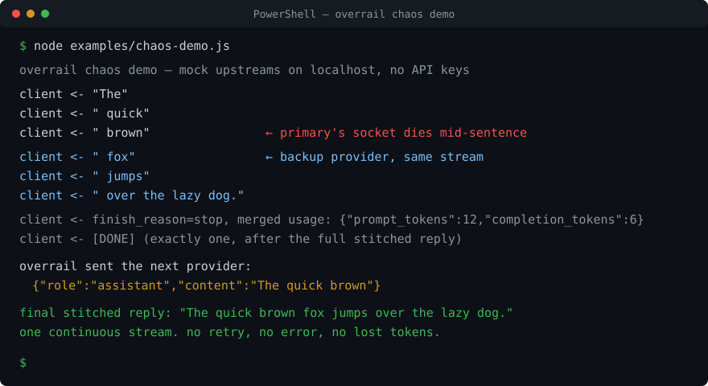

# overrail

**Your AI tool dies when the provider fails. overrail keeps it alive — even mid-answer.**

<p align="center">
  <a href="https://github.com/9qe/overrail/actions/workflows/ci.yml"></a>
</p>

<p align="center">
  
</p>

Free and open source (MIT). Runs entirely on your computer. v0.4.0.

## What it does, in plain English

1. You use an AI coding tool (like Claude Code) with one AI provider (like DeepSeek).
2. Sometimes that provider rate-limits you, or its connection just drops. Your tool freezes or errors out — often halfway through an answer you already paid for.
3. overrail sits in between. When the provider fails, it quietly switches to a backup. If the answer was half-finished, the backup picks up exactly where it stopped. You see one uninterrupted answer.

Your API keys stay on your computer. Requests go straight from you to the provider — nowhere else.

## Try it in 1 minute (no account, no API key)

<p align="center">
  
</p>

You need [Node.js](https://nodejs.org) installed. Open PowerShell (Windows) or Terminal (Mac/Linux) and paste these three lines:

```bash
git clone https://github.com/9qe/overrail.git
cd overrail
node examples/chaos-demo.js
```

What you'll see: the first provider "dies" after three words, a backup finishes the sentence, and your side never shows an error:

```
client <- "The"
client <- " quick"
client <- " brown"        <- first provider dies here
client <- " fox"          <- backup provider takes over, same answer
client <- " jumps"
client <- " over the lazy dog."
client <- [DONE]
```

That's the whole idea. Everything below is about using it with real providers.

## Use it with your own AI provider

Three steps. DeepSeek is the example here; Kimi, OpenRouter, and Ollama work the same way.

**Step 1 — get an API key.** Sign up at https://platform.deepseek.com and create a key. An API key is just a password that lets apps use your account.

**Step 2 — set up overrail.** Open PowerShell and run:

```powershell
npx overrail init
$env:DEEPSEEK_API_KEY = "paste-your-key-here"
```

On Mac/Linux (bash), the second line is: `export DEEPSEEK_API_KEY="paste-your-key-here"`

**Step 3 — start your tool through overrail:**

```powershell
overrail run deepseek -- claude
```

That's Claude Code running on DeepSeek instead of Anthropic. `overrail run` points Claude Code straight at DeepSeek's Anthropic-compatible endpoint — it's provider switching, and it does not go through the gateway. For automatic failover and mid-stream stitching, use the gateway: it now speaks Anthropic's `/v1/messages` as well as OpenAI's `/v1/chat/completions`, so aider, Codex, curl and Claude Code can all sit behind it.

*If Windows says `overrail` is not recognized, run `npm i -g overrail` once, or prefix commands with `npx overrail`.*

---

## For developers

**Kill an LLM provider mid-sentence. Your agent keeps streaming.**

Zero-dependency Node.js CLI (CommonJS, Node >= 18), Windows-first. Install: `npm i -g overrail` or `npx overrail init`.

### Why not LiteLLM, OpenRouter, or another proxy

- **No cloud middleman.** Keys stay in your environment; requests go from your machine straight to the provider. Nothing phones home.
- **No dependency tree.** Zero dependencies, CommonJS, small enough to audit in one sitting. No Python, no Docker, no SDK.
- **Mid-stream stitching, not just retries.** Most routers retry requests that fail before the first token. overrail also catches a severed SSE socket mid-generation and stitches the remainder via assistant prefill, including tool calls, so a 400-line file at token 300 doesn't die at token 300. The tokens already streamed are not regenerated; the backup only produces the remainder. (Both legs can still *bill* for their own partial output — see "What is proven".)

### What is proven, and what is not

Proven by the local suite (82 tests) and `examples/recovery-benchmark.js`, all against fake upstreams on localhost:

- An 8,000-delta stream killed at delta 4,000 and at delta 7,900 reassembles **byte-identical** to the scripted answer, with exactly one `[DONE]`, one finish event, one tool call, and merged usage. Measured client-observed stall across the stitch: **16–34 ms**.
- Malformed SSE, invalid frames, comments, keep-alives, multi-line `data:` payloads, UTF-8 sequences split across network chunks, usage-only chunks and a clean upstream end without `[DONE]` are all handled without corrupting the stream.
- Anthropic `/v1/messages` request/response/stream translation, including `tool_use` blocks.
- The recovery journal records what was emitted and what a client acknowledged, and never writes prompt text or tool arguments.

Not proven, stated plainly:

- **No live-provider evidence yet.** `node examples/live-provider-matrix.js` currently reports 32/32 cases skipped (`evidence_valid: false`) because the keys on this machine are unfunded and Ollama isn't installed. Everything above is local simulation against upstreams that implement our reading of the published SSE contract.
- **No exactly-once side effects.** overrail can prove what *it* emitted and what a cooperating client acknowledged. It cannot prove that a non-cooperating client didn't execute a tool twice, and it cannot un-run a side effect. See [docs/recovery-semantics.md](docs/recovery-semantics.md).
- **Cross-provider continuation is best effort.** A backup provider finishing another provider's sentence is not the same model making the same decision; the remainder can differ semantically.
- **Double billing is possible.** The primary is charged for what it streamed before dying, the backup for the remainder.

### Chaos testing against real providers

Set `OVERRAIL_CHAOS=529` (primary returns overloaded) or `OVERRAIL_CHAOS=midstream_drop@100` (primary's socket dies after 100 content events) and run any request through `overrail serve`. `node examples/chaos-demo.js` runs the same demo against local mock upstreams, no keys needed.

## Gateway

`overrail serve` starts a local gateway at http://127.0.0.1:8787, bound to 127.0.0.1 only. It speaks two dialects:

| route | dialect | notes |
|---|---|---|
| `POST /v1/chat/completions` | OpenAI | failover + mid-stream stitching, streamed and non-streamed |
| `GET /v1/models` | OpenAI | one entry per configured profile |
| `POST /v1/messages` | Anthropic | Messages API translation (system blocks, `tool_use` / `tool_result`, `input_schema`, streaming events) on top of the same failover engine |
| `POST /v1/recovery/:id/ack` | overrail | opt-in execution acknowledgement, see below |

That means Claude Code can be pointed at the gateway (`ANTHROPIC_BASE_URL=http://127.0.0.1:8787`) and get failover and mid-stream stitching, not just provider switching. The translation is covered by the local test suite, not by live-provider runs yet — if Claude Code does something the suite doesn't model, expect it to show up as a translation gap rather than a silent success. `overrail run` remains the simpler path when you only want one provider swapped in.

Point your tools at it:

```
 aider   codex   curl   claude code
   \       |      |       /
    \      |      |      /
     +-----+------+-----+
             |
             v
      overrail serve
    http://127.0.0.1:8787
   /v1/chat/completions + /v1/messages
             |
             v
  deepseek -> kimi -> openrouter -> ollama
     (automatic failover)
```

Test it with curl:

```bash
curl http://127.0.0.1:8787/v1/chat/completions \
  -H "Content-Type: application/json" \
  -d '{"model":"deepseek","messages":[{"role":"user","content":"What is 2+2?"}]}'

curl http://127.0.0.1:8787/v1/messages \
  -H "Content-Type: application/json" \
  -d '{"model":"deepseek","max_tokens":64,"messages":[{"role":"user","content":"What is 2+2?"}]}'
```

If a provider returns 429, 500, 502, 503, 504, or 529, or the connection fails, the gateway moves to the next profile in the chain. Default chain: `deepseek -> kimi -> openrouter -> ollama`. Local chain: `ollama`. The `model` field in gateway calls takes `<profile>` (for example `deepseek`) or `<profile>/<model>`.

### Durable tool recovery (opt-in)

Send an idempotency key and the gateway journals the tool calls it emitted, then answers `x-overrail-recovery-id`:

```bash
curl http://127.0.0.1:8787/v1/chat/completions \
  -H "Content-Type: application/json" \
  -H "Idempotency-Key: run-42-step-3" \
  -d '{"model":"deepseek","stream":true,"messages":[...],"tools":[...]}'
```

After the client actually runs a call, it says so:

```bash
curl -X POST http://127.0.0.1:8787/v1/recovery/<recovery-id>/ack \
  -H "Content-Type: application/json" \
  -d '{"tool_call_id":"call_abc"}'
```

On the next request with the same key, continuation history distinguishes four states — executed (acknowledged), delivered but unacknowledged (side-effect state unknown, do not repeat), generated but never delivered (regenerate), and abandoned. The journal is append-only JSONL at `~/.overrail/recovery.jsonl` (`OVERRAIL_RECOVERY_DIR` overrides) and stores **metadata only**: recovery id, request hash, tool-call id, function name, a SHA-256 of the arguments, phase, provider, and timestamp. Prompts and arguments are never written to disk. Requests without the header behave exactly as before. Full semantics and limits: [docs/recovery-semantics.md](docs/recovery-semantics.md).

## Built-in profiles

| profile | base URL | env var | note |
|---|---|---|---|
| `deepseek` | `https://api.deepseek.com/v1` | `DEEPSEEK_API_KEY` | first in the default failover chain |
| `kimi` | `https://api.moonshot.ai/v1` | `MOONSHOT_API_KEY` | second in the default failover chain |
| `openrouter` | `https://openrouter.ai/api/v1` | `OPENROUTER_API_KEY` | hundreds of models |
| `ollama` | `http://localhost:11434/v1` | none | local, no key |

## Commands

| command | description |
|---|---|
| `overrail init` | set up profiles and configuration |
| `overrail list` | list profiles |
| `overrail use <name>` | set the active profile |
| `overrail current` | show the active profile |
| `overrail env <name>` | print the environment variables a profile would inject |
| `overrail run [name] -- <cmd...>` | run a command with the profile's environment injected |
| `overrail serve [--port N]` | start the local gateway (default port 8787) |
| `overrail usage` | view usage logged in `~/.overrail/usage.jsonl` |
| `overrail chains` | show failover chains |
| `overrail help` | show help |

## How it works

- **Env injection.** `overrail run deepseek -- claude` launches Claude Code pointed at DeepSeek using your own `DEEPSEEK_API_KEY`. Your workflow does not change; the model under it does.
- **Local gateway.** `overrail serve` runs on http://127.0.0.1:8787, bound to 127.0.0.1 only, with two dialects: OpenAI (`POST /v1/chat/completions`, `GET /v1/models`) and Anthropic (`POST /v1/messages`).
- **Failover.** When a provider returns 429, 500, 502, 503, 504, or 529, or the network errors out, the gateway moves to the next profile in the chain. Default: `deepseek -> kimi -> openrouter -> ollama`. Local: `ollama`.
- **Mid-stream failover.** If the upstream socket dies mid-response, the gateway replays your messages plus the partial reply as an assistant prefill (DeepSeek: `prefix: true` on its beta endpoint; providers that reject a trailing assistant message get a constrained continue prompt instead). The client sees one continuous response, a single `[DONE]`, and merged token usage. Continuation across providers is best-effort: the backup finishes the sentence, but it is a different model and the remainder can differ semantically.
- **Tool-call recovery.** Tool-call arguments are buffered until the JSON is complete, with SSE keep-alives during long calls. Because partial calls never reach the client, a drop mid-tool-call discards the buffer and regenerates the call on the backup provider. Calls that already completed are passed to the backup as finished history, so they're never generated twice *by the gateway*. With an `Idempotency-Key`, that hand-off becomes durable across requests (see "Durable tool recovery").
- **Recovery framing, verified.** The SSE reader holds one `StringDecoder` per stream, so a UTF-8 sequence split across network chunks arrives intact, and every outgoing frame re-prefixes each `data:` line, so multi-line payloads survive. Both were real bugs, both are reproduced and covered by `test/edge-stream.test.js`.
- **Chaos testing.** Set `OVERRAIL_CHAOS=529` to make the first upstream attempt return 529, or `OVERRAIL_CHAOS=midstream_drop@100` to kill the primary stream after 100 content events. Reproduce a failover on your own machine in 30 seconds, no real outage required.
- **Usage log.** Gateway requests are appended to `~/.overrail/usage.jsonl` (provider, model, and token counts; streaming responses are logged when the upstream reports usage). Run `overrail usage` to view it.

## Tests and evidence

```bash
npm test                                   # 82 tests, no network, no keys
node examples/chaos-demo.js                # visible mid-stream stitch on localhost mocks
node examples/recovery-benchmark.js --out docs/benchmark-results.json
node examples/live-provider-matrix.js      # real providers; needs funded keys (currently BLOCKED)
```

Suites: `test/edge-stream.test.js` (malformed SSE, UTF-8 splits, multi-line frames, usage-only chunks), `test/midstream.test.js` (stitching, tool buffering), `test/anthropic.test.js` + `test/anthropic-gateway.test.js` (translation and end-to-end `/v1/messages`), `test/recovery.test.js` + `test/recovery-gateway.test.js` (journal, ack route, idempotency), plus gateway/failover/config/usage. Methodology and limits: [docs/benchmarks.md](docs/benchmarks.md), [docs/provider-matrix.md](docs/provider-matrix.md), [docs/recovery-semantics.md](docs/recovery-semantics.md).

### Design

- Zero dependencies. CommonJS. Requires Node >= 18.
- Windows-first.
- No telemetry. No proxy-to-cloud. Nothing runs in the background when you close the terminal.
- Keys never leave your machine — requests go from your machine straight to the provider.

## Roadmap

Planned for vNext, in order:

1. Live-provider proof: run `examples/live-provider-matrix.js` against funded DeepSeek + a second provider and commit the sanitized results, including a TCP-level kill at random byte offsets.
2. Anthropic translation hardening against real Claude Code traffic once (1) exists.
3. Windows tray app.
4. Cost estimates with an editable price table.
5. Smart task-based model routing.

The order is deliberate: reliability evidence first, convenience features second.

## Support

overrail is free and MIT-licensed, and the core stays that way. If it saves you a mid-task provider migration, sponsor the work at https://github.com/sponsors/9qe.

## License

MIT. See [LICENSE](LICENSE).
