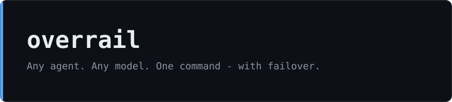
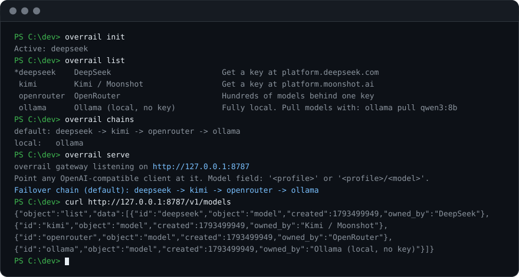

# overrail

**Any agent. Any model. One command — with failover.**

<p align="center">
  
</p>
<p align="center">
  
</p>

Zero-dependency Node.js CLI (CommonJS, Node >= 18), Windows-first, MIT. v0.2.0. Not on npm yet — install straight from GitHub.

## Why

Agent CLIs are wired to one vendor. Switching means env-var archaeology and lost work mid-task. overrail swaps the model under the agent and fails over automatically when a provider rate-limits you.

## Quickstart

PowerShell:

```powershell
npx github:9qe/overrail init
$env:DEEPSEEK_API_KEY = "your-key-here"   # get a key at https://platform.deepseek.com
overrail run deepseek -- claude
```

bash:

```bash
npx github:9qe/overrail init
export DEEPSEEK_API_KEY="your-key-here"   # get a key at https://platform.deepseek.com
overrail run deepseek -- claude
```

If `overrail` is not on your PATH, run commands as `npx github:9qe/overrail <command>`.

## Gateway

`overrail serve` starts a local OpenAI-compatible gateway at http://127.0.0.1:8787. It exposes `POST /v1/chat/completions` and `GET /v1/models`, and binds to 127.0.0.1 only.

Point your tools at it:

```
claude   codex   aider   curl
   \       |       |      /
    \      |       |     /
     +-----+---+---+----+
             |
             v
      overrail serve
    http://127.0.0.1:8787
             |
             v
  deepseek -> kimi -> openrouter -> ollama
     (automatic failover)
```

Test it with curl:

```bash
curl http://127.0.0.1:8787/v1/chat/completions \
  -H "Content-Type: application/json" \
  -d '{"model":"deepseek","messages":[{"role":"user","content":"What is 2+2?"}]}'
```

If a provider returns 429, 500, 502, 503, or 504, or the connection fails, the gateway moves to the next profile in the chain. Default chain: `deepseek -> kimi -> openrouter -> ollama`. Local chain: `ollama`. The `model` field in gateway calls takes `<profile>` (for example `deepseek`) or `<profile>/<model>`.

## Built-in profiles

| profile | base URL | env var | note |
|---|---|---|---|
| `deepseek` | `https://api.deepseek.com/v1` | `DEEPSEEK_API_KEY` | first in the default failover chain |
| `kimi` | `https://api.moonshot.ai/v1` | `MOONSHOT_API_KEY` | second in the default failover chain |
| `openrouter` | `https://openrouter.ai/api/v1` | `OPENROUTER_API_KEY` | hundreds of models |
| `ollama` | `http://localhost:11434/v1` | none | local, no key |

## Commands

| command | description |
|---|---|
| `overrail init` | set up profiles and configuration |
| `overrail list` | list profiles |
| `overrail use <name>` | set the active profile |
| `overrail current` | show the active profile |
| `overrail env <name>` | print the environment variables a profile would inject |
| `overrail run [name] -- <cmd...>` | run a command with the profile's environment injected |
| `overrail serve [--port N]` | start the local gateway (default port 8787) |
| `overrail usage` | view usage logged in `~/.overrail/usage.jsonl` |
| `overrail chains` | show failover chains |
| `overrail help` | show help |

## How it works

- **Env injection.** `overrail run deepseek -- claude` launches Claude Code pointed at DeepSeek using your own `DEEPSEEK_API_KEY`. Your workflow does not change; the model under it does.
- **Local gateway.** `overrail serve` runs an OpenAI-compatible endpoint (`POST /v1/chat/completions`, `GET /v1/models`) on http://127.0.0.1:8787, bound to 127.0.0.1 only.
- **Failover.** When a provider returns 429, 500, 502, 503, 504, or 529, or the network errors out, the gateway moves to the next profile in the chain. Default: `deepseek -> kimi -> openrouter -> ollama`. Local: `ollama`.
- **Mid-stream failover.** If the upstream socket dies mid-response, the gateway replays your messages plus the partial reply as an assistant prefill to the next provider and stitches the rest onto the same stream. The client sees one continuous response, a single `[DONE]`, and merged token usage. Tool-call arguments are buffered until the JSON is complete, with SSE keep-alives during long calls. Streams that die mid-tool-call with no text cannot be continued safely and are dropped.
- **Chaos testing.** Set `OVERRAIL_CHAOS=529` to make the first upstream attempt return 529, or `OVERRAIL_CHAOS=midstream_drop@100` to kill the primary stream after 100 content events. Reproduce a failover on your own machine in 30 seconds, no real outage required.
- **Usage log.** Gateway requests are appended to `~/.overrail/usage.jsonl` (provider, model, and token counts; streaming responses are logged when the upstream reports usage). Run `overrail usage` to view it.

### Design

- Zero dependencies. CommonJS. Requires Node >= 18.
- Windows-first.
- No telemetry. No proxy-to-cloud. Nothing runs in the background when you close the terminal.
- Keys never leave your machine — requests go from your machine straight to the provider.

## Roadmap

Planned for vNext, in no particular order:

- Windows tray app
- Cost estimates with an editable price table
- Smart task-based model routing
- Profile support for more agents

## Support

overrail is free and MIT-licensed, and the core stays that way. If it saves you a mid-task provider migration, sponsor the work at https://github.com/sponsors/9qe. The full monetization plan is documented in [docs/MONETIZATION.md](docs/MONETIZATION.md).

## License

MIT. See [LICENSE](LICENSE).
